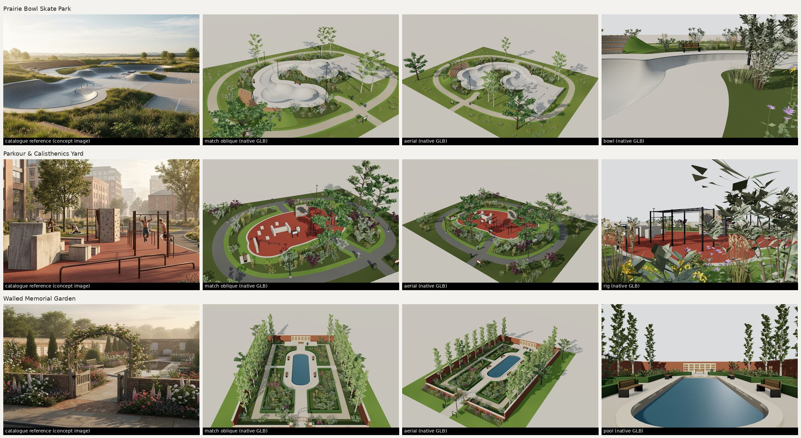

# Park batch 1: skate park, parkour yard, memorial garden

## Scope

Three new native parks for catalogue archetypes that had reference images but no
3D park. Each is one self-contained assembly GLB at true size, registered as a
local pilot (`status: pilot`, `runtimeStatus: not_tested`) like the other native
parks. With these, the Calgary guide has 30 native park types.

| Park | Variant id | Archetype | Group | Site |
|---|---|---|---|---:|
| Prairie Bowl Skate Park | `student_prairie_bowl_skate_park_v1` | `skate_park` | play_sport | 64 x 52 m |
| Parkour & Calisthenics Yard | `student_parkour_calisthenics_yard_v1` | `outdoor_fitness_circuit` | play_sport | 44 x 36 m |
| Walled Memorial Garden | `student_walled_memorial_garden_v1` | `memorial_garden` | gardens | 36 x 50 m |

The batch first named an inclusive playground, a community garden and a pump
track. Those three already exist in the app as cards under other ids, so the
batch moved to the next archetypes with no 3D park.

Each row: the catalogue reference image, then the native GLB from a matching
oblique, from the air, and close up. Renders are made in headless Chromium from
the delivered GLB, not from the generator's memory of it.

## Design basis

Each park is an original concept after one catalogue reference set. Nothing is
traced. The references set the programme and the mood; the plan, dimensions and
planting are authored for Calgary teaching use.

- **Prairie Bowl Skate Park** follows `skate-park/variant_2` ("prairie bowls").
  It has three linked concrete bowls set into native prairie planting:
  - a 2.4 m kidney bowl;
  - a 1.8 m clover bowl;
  - a 1.3 m snake run.
  It also has:
  - curved timber terrace seating in a grass berm;
  - a street plaza with a stair set, handrail, hubba, ledges, flat rail, manual
    pad and bank;
  - a gravel entrance spur and loop, and aspen and bur oak.
- **Parkour & Calisthenics Yard** follows `outdoor-fitness-circuit/variant_1`. It
  has a red rubber movement floor with concrete vault walls and precision blocks,
  plus:
  - a bouldering wall;
  - a pull-up rig with monkey bars;
  - a hexagonal climbing frame;
  - dip bars and balance rails.
  An asphalt loop winds through lawn, a grass mound and dense planting.
- **Walled Memorial Garden** follows `memorial-garden/variant_3`. It is a
  brick-walled garden entered through a timber rose arbour, with:
  - a 5 by 17 m reflecting pool on the axis;
  - stone terraces and paths, and a perimeter gravel walk;
  - four hedged beds of perennials and roses;
  - Swedish columnar aspen along the walls;
  - a back terrace before a wall of blank plaques.
  The plaques commemorate no real person or event.

## How they are built

`tools/native_park_batch/` builds all three in pure Python (numpy, shapely,
earcut), with no Blender and no paid calls:

- **Plan.** Shapely polygons, triangulated in grid cells.
- **Bowls.** The bowls, berms and mound are smooth Delaunay heightfields.
- **Plants.** Plants come from the shared local foliage generator as instances.
- **Materials.** Every material is named for the runtime: `paving`, `grass`,
  `gravel`, `rubber`, `water`, `foliage` and the rest.

| Park | Triangles rendered | Mesh instances | GLB bytes | Route segments |
|---|---:|---:|---:|---:|
| Prairie Bowl Skate Park | 710,683 | 534 | 10,072,412 | 59 |
| Parkour & Calisthenics Yard | 467,560 | 321 | 6,612,740 | 51 |
| Walled Memorial Garden | 801,073 | 448 | 7,660,748 | 34 |

The GLBs use vertex colours and stored normals, with no textures.

## Runtime contract

- Each assembly owns its ground and stays rigid. A larger parcel leaves room
  around it; nothing stretches.
- Prepared level ground only.
- One entrance on the south edge of each site.
- Walking surfaces:
  - skate park: `paving`, `grass`, `gravel`;
  - parkour yard: `paving`, `grass`, `rubber`;
  - memorial garden: `paving`, `gravel`, `grass`.
- The skate bowls are below the walk height band, so walkers stay on the deck,
  plaza, paths and grass. The pool is `water`, a hazard, as everywhere in the
  runtime.

## Verification

- **Offline geometry.** `tools/native_park_batch/verify.py` reads each delivered
  GLB and passes (`PASS_OFFLINE_GEOMETRY`). It checks:
  - hashes, self-contained buffers and no textures;
  - the footprint, and recipe bounds that match the GLB;
  - below-grade geometry only inside the declared sunken areas;
  - material-aware route rays across every route's width;
  - plant origins clear of every route;
  - a walkable entrance;
  - each park's own extras:
    - skate park: bowl depths and steel coping along every bowl edge;
    - parkour yard: frames over the rubber, with 1.5 m of rubber beyond the
      posts;
    - memorial garden: one water plane 0.25 m down, and full-height side walls.
- **Rebuild test.** `tools/native_park_batch/test_native_park_batch.py` (10
  tests) rebuilds all three. It checks that:
  - each assembly matches the registered bytes;
  - each recipe matches its seed package;
  - the frontend and backend registries agree;
  - the offline checks reproduce the committed reports.
  The skate park was registered before the shared kit grew for the other two.
  Its GLB still rebuilds byte for byte, and its recipe keeps the kit hash it was
  built with.
- **Runtime walk test.** `frontend/src/features/parks/parkBatch1.test.ts` loads
  each registered layout through the runtime walk code. Entrances, paths, the
  plaza, the rubber floor, the pool terrace and the perimeter walk are walkable.
  The bowl floors, the pool and the area outside each site are not.
- **Full frontend suite.** 517 files and 4,645 tests pass. Type check and lint
  are clean, and the catalogue delivery tests (135) pass. Count tests now
  expect the three new parks (49 green-space objects, 30 classroom parks,
  212 lessons). The production roster test names them as explicit additions.
- **Backend.** Registry tests (59) pass, and both registry copies are identical.
- **Runtime asset manifest.** 6,054 required files, current.

## Registration

`scripts/register_park_batch1.py` registers the three through
`register_classroom_park.register`. It refuses any model that differs from the
reviewed hash. It added:

- **Layouts.** Three layouts in both `nativeParks.json` copies.
- **Seed packages.** One per park under `seed/classroom-parks/`:
  - `prairie-bowl-skate-v006`, `parkour-yard-v004`, `walled-memorial-v004`;
  - each holds the recipe, GLB, card image, geometry report and runtime review.
- **Staged assets.** The GLBs and card images in
  `frontend/public/native-park-assets/`, on LFS.
- **Cards and catalogue data.** Card entries in `classroomExpansion.json`, plus
  park programmes, presentation copy, hero images and planning lessons.

The registrar's rewrite of `classroomExpansion.json` was replaced by a
text-level splice of the three entries.

## Open checkpoints

- **Runtime: NOT TESTED.** Nothing was placed in the running app. Each seed
  package holds a filled `runtime-review.md`: 40 rows NOT TESTED, 28 N/A, none
  passed.
- **Independent review:** not done. The review views above are the builder's own.
- **Human visual acceptance and publication:** open.
- **Design limits**, also listed in each recipe:
  - The bowls, equipment, fall zones and pool are indicative teaching models,
    not designs. Real skate parks are designed by specialist firms. Fitness
    equipment follows the manufacturer and the play and fitness standards.
  - Drainage and pool filtration are not modelled.
