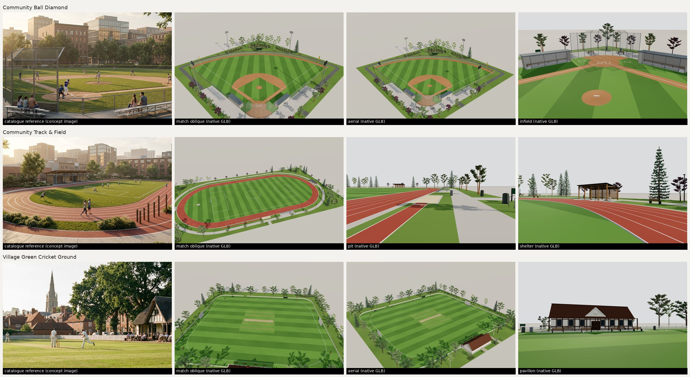

# Park batch 2: ball diamond, running track, cricket ground

## Scope

Three new native parks for sports-ground archetypes that had reference images but
no 3D park. Each is one self-contained assembly GLB at true size, registered as a
local pilot (`status: pilot`, `runtimeStatus: not_tested`) like batch 1. With these,
the Calgary guide has 33 native park types.

| Park | Variant id | Archetype | Group | Site |
|---|---|---|---|---:|
| Community Ball Diamond | `student_community_ball_diamond_v1` | `baseball_softball_diamond` | play_sport | 88 x 88 m |
| Community Track & Field | `student_community_track_field_v1` | `running_track_oval` | play_sport | 200 x 112 m |
| Village Green Cricket Ground | `student_village_green_cricket_v1` | `cricket_pitch_oval` | play_sport | 120 x 120 m |

These grounds are much larger than the earlier parks. The track is the largest
native park so far, so students need a big parcel for it.

Each row: the catalogue reference image, then the native GLB from a matching
oblique and two closer views. Renders are made in headless Chromium from the
delivered GLB.

## Design basis

Each park is an original concept after one catalogue reference set, not a traced
design. The playing areas use standard dimensions as teaching values.

- **Community Ball Diamond** follows `baseball-softball-diamond/variant_0`
  ("Urban Community Diamond"). It is a Little League-sized field:
  - 60 ft (18.29 m) bases, a 46 ft (14.02 m) pitching distance and a 200 ft
    (61 m) outfield fence with a yellow cap and foul poles;
  - a grass infield inside a 50 ft dirt arc, a raised mound, a warning track and
    chalked foul lines, batter's boxes and on-deck circles;
  - a 6 m chain-link backstop with a hood, side fences, two block dugouts;
  - aluminium bleachers and benches on a concrete apron;
  - four field lights, a blank scoreboard, and a path loop round the outfield
    through lawn, prairie beds, flowering cherries and groves.
- **Community Track & Field** follows `running-track-athletic-oval/variant_1`
  ("Community Park Track"):
  - a six-lane 400 m track on the standard geometry: 36.5 m bends, 84.39 m
    straights and 1.22 m lanes, with an inner kerb, lane lines, 400 m stagger
    starts and a finish line;
  - a grass infield with a 100 x 64 m soccer pitch and goals;
  - a long jump runway and sand pit, and a shot put circle and sector;
  - a concrete walk ringing the track with lights and benches;
  - bleachers, a timber shelter, a hurdle stack, a timber fitness station, shrub
    beds and tree groves.
- **Village Green Cricket Ground** follows `cricket-ground/variant_0`
  ("Village Green"):
  - a rounded ground inside a white picket fence, with a boundary rope 42 to 46 m
    from the pitch centre;
  - a square of mown strips with the active 22-yard pitch, creases and stumps;
  - white wheeled sight screens at both ends;
  - a timber-framed pavilion with a veranda, a blank clock and a terrace of
    benches;
  - a scoreboard, a roller, benches round the boundary, and bur oak, green ash,
    aspen and spruce outside the fence.

## How they are built

The three parks use `tools/native_park_batch/` like batch 1. Their sports
pieces live in a new `sportskit.py`:
- chain-link and picket fences, bleachers, dugouts, field lights and scoreboards;
- goals, a timber shelter and hurdles;
- chalk markings and mowing stripes.

`parkkit.py` is unchanged, so batch 1 keeps its recorded source hashes. A park
lists extra kit files in `KIT_SOURCES`, and `build.py` adds them to that park's
generator hash.

| Park | Triangles rendered | Mesh instances | GLB bytes | Route segments |
|---|---:|---:|---:|---:|
| Community Ball Diamond | 714,184 | 389 | 11,411,116 | 48 |
| Community Track & Field | 838,476 | 208 | 10,649,608 | 83 |
| Village Green Cricket Ground | 780,399 | 200 | 9,010,032 | 54 |

Each unique tree species adds about 1 MB to a GLB. Each park therefore uses at most
six tree species, which keeps every model under 12 MB. Shrubs cost 2,000 to 4,500
triangles each, so the large grounds rely on trees for mass and keep shrub beds small.

## Runtime contract

- Each assembly owns its ground and stays rigid. A larger parcel leaves room
  around it; nothing stretches. Prepared level ground only, with one entrance on the
  south edge.
- Walking surfaces:
  - ball diamond: `paving`, `grass`, `gravel` (the infield and warning track);
  - track: `paving`, `grass`, `rubber` (lanes and runway), `gravel` (the sand pit);
  - cricket ground: `paving`, `grass`, `gravel`.
- Fences, dugouts, the backstop and the pavilion are steep faces, so the runtime
  treats them as barriers.
- Chalk lines and the boundary rope are flat, so walkers can cross them.

## Verification

- **Offline geometry.** `tools/native_park_batch/verify.py` passes on each
  delivered GLB (`PASS_OFFLINE_GEOMETRY`: 16, 17 and 15 checks). Besides the
  shared checks, each park has its own:
  - ball diamond: the fence is 61 m from home on both foul lines and in centre
    field; bases 18.29 m apart and the rubber 14.02 m from home; a 6 m backstop;
    nothing standing in fair territory but the bases and the rubber;
  - track: inner and outer track edges at 36.5 and 43.82 m; six lane lines
    1.22 m apart; a 400.00 m lap in lane one; the pitch fits inside the kerb;
    nothing on the track or infield but the goals;
  - cricket ground: stumps 20.12 m apart; the rope at least 42 m from the pitch
    centre; nothing inside the boundary but the stumps.
  - The route rays (1,710, 3,000 and 2,400) all land on walkable ground, and every
    plant origin is clear of the routes.
- **Rebuild test.** `tools/native_park_batch/test_native_park_batch.py`, now 19
  tests, rebuilds all six batch parks byte for byte and re-runs the checks.
- **Runtime walk test.** `frontend/src/features/parks/parkBatch2.test.ts` loads
  each registered layout through the runtime walk code:
  - walkable: entrances, the apron, the infield, the mound top, the walking loop,
    a lane, the soccer pitch, the sand pit, the terrace, the pitch and the
    boundary walk;
  - not walkable: the inside of the closed pavilion and the area outside each site.
- **Land use.** The three parks are screened as Outdoor Recreation Area (s.248),
  like the existing sports green. The land-use test now covers them: permitted
  in S-SPR, discretionary in S-R and outside in R-CG.
- **Full frontend suite.** 518 files and 4,651 tests pass, with a clean type check
  and lint. The catalogue delivery tests (135) and the catalogue checks pass.
- **Count tests** now expect the three new parks: 52 green-space objects, 33
  classroom parks, 215 lessons, 38 permitted parks in S-SPR and 11 discretionary
  in S-R.
- **Backend.** The park tests (62) pass. The rotation test placed every park in a
  fixed 160 m parcel, which the 200 m track cannot rotate inside. Its parcel is
  now sized to each layout's rotated extent, and never smaller than before.
- **Runtime asset manifest.** 6,060 required files, current.

## Registration

`scripts/register_park_batch2.py` registers the three parks through
`register_classroom_park.register`. It refuses any model that differs from the
reviewed hash. The final builds are byte-identical to the reviewed versions
(diamond v004, track v004, cricket v002). It added:

- **Layouts** in both `nativeParks.json` copies.
- **Seed packages** `community-diamond-v005`, `community-track-v005` and
  `village-cricket-v003`, each with its recipe, GLB, card image, geometry report and
  runtime review.
- **Staged assets** in `frontend/public/native-park-assets/`, on LFS.
- **Cards** in `classroomExpansion.json`, spliced as text in batch 1's format.
- **Catalogue data:** presentation copy, hero images (the reference variants), park
  programmes (Outdoor Recreation Area) and planning lessons.

## Open checkpoints

- **Runtime: NOT TESTED.** Nothing was placed in the running app. Each seed
  package holds a filled `runtime-review.md`: 40 rows NOT TESTED, 28 N/A, none
  passed. The track especially needs a placement trial, because of its size.
- **Independent review:** not done. The review views above are the builder's own.
- **Human visual acceptance and publication:** open.
- **Design limits**, also listed in each recipe:
  - Fields, fences, lights and the pavilion are indicative. Real facilities
    follow the governing bodies, manufacturers and building and lighting rules.
  - Drainage, irrigation, the infield mix, the track build-up and the cricket
    square are not designed.
  - The scoreboards and the clock are blank.
