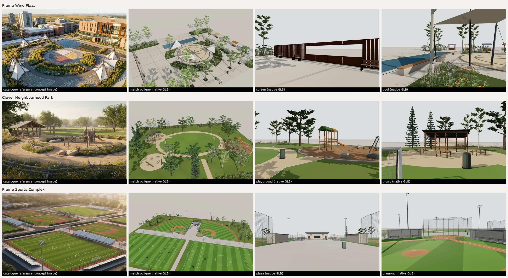

# Park batch 3: prairie plaza, neighbourhood park, sports complex

## Scope

Three new native parks for archetypes that had reference images but no 3D park. Each
is one self-contained assembly GLB at true size, registered as a local pilot
(`status: pilot`, `runtimeStatus: not_tested`) like batches 1 and 2. With these,
the Calgary guide has 36 native park types.

| Park | Variant id | Archetype | Guide group | Site |
|---|---|---|---|---:|
| Prairie Wind Plaza | `student_calgary_prairie_plaza_v1` | `calgary_prairie_plaza` | plazas | 64 x 52 m |
| Clover Neighbourhood Park | `student_clover_neighbourhood_park_v1` | `neighborhood_park` | neighbourhood | 84 x 68 m |
| Prairie Sports Complex | `student_prairie_sports_complex_v1` | `sports_field_complex` | play_sport | 216 x 168 m |

The sports complex is now the largest native park, so students need a big parcel
for it.

Each row: the catalogue reference image, then the native GLB from a matching
oblique and two closer views.

## Design basis

Each park is an original concept after one catalogue reference set. None is traced.

- **Prairie Wind Plaza** follows `calgary-prairie-urban-plaza/variant_2`:
  - a sandstone gathering circle inlaid with a granite wind rose, and a paved
    ring walk;
  - crescents of rough fescue, feather reed grass, blue grama and prairie flowers,
    with glacial-erratic boulders as seats;
  - three white shade sails and a long reflecting pool with plinth benches;
  - a market strip of five timber stalls;
  - a slotted weathering-steel wind screen with a framed view west toward the
    mountains;
  - trees in grates on the forecourt, and aspen groves.

  The reference's four-colour circle reads as a medicine wheel, a sacred
  Indigenous symbol, so it is not reproduced as decoration. The centre is a
  neutral wind rose that nods to Calgary's chinook winds.
- **Clover Neighbourhood Park** follows `neighborhood-park/variant_0`:
  - an open oval lawn with two small goals, ringed by a stone-dust walk with
    benches;
  - a playground on wood-fibre surfacing: two timber towers, a bridge, a slide, a
    climbing net, swings, boulders and log steppers, with a level entry through
    its curb;
  - a picnic shelter with tables, and a nature-play corner of boulders and logs;
  - a split-rail fence and wildflower meadow along the south edge, and scattered
    shade trees.
- **Prairie Sports Complex** follows `sports-field-complex/variant_0`:
  - two 90 x 60 m soccer pitches with full markings, goals, bleachers and field
    lights;
  - two Little League diamonds (60 ft bases, 200 ft fences) with backstops,
    dugouts, bleachers, lights and scoreboards;
  - the diamonds' home plates face a central plaza and a fieldhouse with a
    concession window and washrooms;
  - an east-west promenade between the fields, an entrance spine with bike racks,
    prairie beds and tree groves.

## How they are built

The three parks use `tools/native_park_batch/` with a new `playkit.py`:
- shade sails, market stalls, the wind screen and boulders;
- paver bands and tree grates;
- play towers, a bridge, a slide, a climbing net and swings;
- a split-rail fence, picnic tables and a fieldhouse.

The complex reuses `sportskit.py` unchanged. Its two diamonds are drawn in a
local frame (home plate at the origin) and rotated into place, so one builder
makes both orientations.

`parkkit.py` and `sportskit.py` are part of registered parks' source hashes, so
they stay unchanged. New pieces go into a new kit file, listed in the park's
`KIT_SOURCES`.

| Park | Triangles rendered | Mesh instances | GLB bytes | Route segments |
|---|---:|---:|---:|---:|
| Prairie Wind Plaza | 771,638 | 481 | 6,239,808 | 44 |
| Clover Neighbourhood Park | 656,108 | 378 | 8,743,796 | 55 |
| Prairie Sports Complex | 661,411 | 304 | 10,260,144 | 3 |

## Runtime contract

- Each assembly owns its ground and stays rigid. A larger parcel leaves room
  around it; nothing stretches. Prepared level ground only, with one entrance on
  the south edge.
- Walking surfaces:
  - plaza: `paving` and `grass`;
  - neighbourhood park: `grass`, `gravel` (stone dust and the play surfacing),
    and `paving`;
  - complex: `paving`, `grass`, `gravel`.
- The reflecting pool is `water`, a hazard. The fieldhouse, the shelter, fences
  and the wind screen are barriers.

## Verification

- **Offline geometry.** `tools/native_park_batch/verify.py` passes on each
  delivered GLB (15, 14 and 15 checks). The route rays (1,155, 1,047 and 1,977)
  all land on walkable ground. Each park also has its own checks:
  - plaza: one water plane 0.1 m below the coping; sails above 2.4 m over the
    circle and ring walk; a clear view opening in the wind screen;
  - neighbourhood park: every play tower at least 1.8 m inside the surfacing, and
    nothing standing on the open lawn but its two goals;
  - complex: both diamonds' fences at 61 m and second base at 60 ft; both pitches
    marked at 90 x 60 m; nothing on either pitch but its goals.
- **Rebuild test.** `tools/native_park_batch/test_native_park_batch.py` (28
  tests) rebuilds all nine batch parks byte for byte.
- **Runtime walk test.** `frontend/src/features/parks/parkBatch3.test.ts` checks
  surfaces through the runtime walk code:
  - walkable: entrances, the sandstone circle, the ring walk, the pool coping, the
    market strip, the lawn, the playground surfacing, the picnic pad, the
    promenade, a pitch, the infield and both mound tops;
  - not walkable: the reflecting pool, the inside of the fieldhouse and the area
    outside each site.
- **Land use.** The plaza and the neighbourhood park screen as Park (s.249). The
  complex screens as Outdoor Recreation Area (s.248). The land-use tests now
  cover all three:
  - S-SPR: 41 permitted parks;
  - R-CG: 30 permitted parks;
  - S-R: 12 discretionary parks.
- **Full frontend suite.** 520 files and 4,671 tests pass, with a clean type check
  and lint. The catalogue delivery tests (126) and the catalogue checks pass.
- **Count tests** now expect 55 green-space objects, 36 classroom parks and 218
  lessons.
- **Backend.** The park tests (65) pass.
- **Bundle.** A fresh production build is 8,527.7 KB of JS, within the 8,544 KB
  budget. That budget was raised by 32 KB in its own commit before this batch;
  batch 3 adds about 5 KB.
- **Runtime asset manifest.** 6,066 required files, current.

## Registration

`scripts/register_park_batch3.py` registers the three parks, with exact model
hashes. The final builds are byte-identical to the reviewed versions (plaza v005,
neighbourhood v004, complex v002). It added:

- **Layouts** in both `nativeParks.json` copies.
- **Seed packages** `prairie-wind-plaza-v006`, `clover-neighbourhood-v005` and
  `prairie-sports-complex-v003`.
- **Staged assets** in `frontend/public/native-park-assets/`, on LFS.
- **Cards** spliced as text into `classroomExpansion.json`.
- **Catalogue data:** presentation copy, hero images, park programmes and
  planning lessons.

## Open checkpoints

- **Runtime: NOT TESTED.** Nothing was placed in the running app. Each seed
  package holds a filled `runtime-review.md`: 40 rows NOT TESTED, 28 N/A, none
  passed. The complex most needs a placement trial, because of its size.
- **Independent review:** not done. The review views are the builder's own.
- **Human visual acceptance and publication:** open.
- **Design limits**, also listed in each recipe:
  - Shade sails, the wind screen, play equipment, lights and the fieldhouse are
    indicative and need engineering or standards review. Playgrounds follow CSA
    Z614.
  - Drainage, the pool's water treatment and turf construction are not designed.
  - The wind rose points to the park's north, not a surveyed true north.
