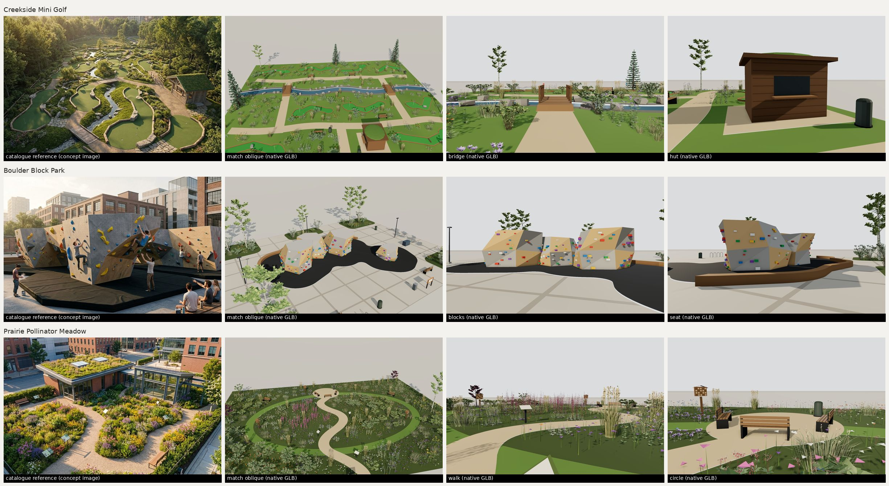

# Park batch 4: mini golf, bouldering park, pollinator meadow

## Scope

Three new native parks for archetypes that had reference images but no 3D park. Each
is one self-contained assembly GLB at true size, registered as a local pilot
(`status: pilot`, `runtimeStatus: not_tested`) like batches 1 to 3. With these, the
Calgary guide has 39 native park types.

| Park | Variant id | Archetype | Guide group | Site |
|---|---|---|---|---:|
| Creekside Mini Golf | `student_creekside_mini_golf_v1` | `mini_golf_course` | play_sport | 48 x 40 m |
| Boulder Block Park | `student_boulder_block_park_v1` | `climbing_bouldering_wall` | play_sport | 40 x 32 m |
| Prairie Pollinator Meadow | `student_prairie_pollinator_meadow_v1` | `pollinator_meadow` | nature | 48 x 36 m |

Each row: the catalogue reference image, then the native GLB from a matching
oblique and two closer views.

## Design basis

Each park is an original concept after one catalogue reference set. None is traced.

- **Creekside Mini Golf** follows `mini-golf-putting-course/variant_3`, the nature
  course:
  - nine organic carpet greens with timber edging, tee mats, cups and coloured
    flags, and boulder and log obstacles;
  - the greens are laid along a meandering, rock-lined creek;
  - a curving stone-dust path loop crosses the creek on two timber footbridges;
  - a sod-roof starter hut stands by the entrance.

  The stock windmill, castle and ship set pieces of variant 0 are left out.
- **Boulder Block Park** follows `outdoor-climbing-bouldering-wall/variant_0`:
  - a chain of three joined, angular blocks, 3.2 to 3.6 m tall, and a separate
    2.0 m children's block;
  - their walls fold at mid-height, lean and overhang, in alternating grey and
    plywood-toned panels dotted with coloured holds;
  - one continuous black rubber fall zone at least 2.5 m wide round every block;
  - a timber seat edge, banded paving, a gear box, prairie beds and aspens.
- **Prairie Pollinator Meadow** follows
  `pollinator-meadow-wildflower-garden/variant_1`:
  - drifts of native prairie flowers among rough fescue, blue grama, feather reed
    grass and june grass: wild bergamot, blanketflower, goldenrod, fireweed, wild
    blue flax, prairie crocus, prairie smoke, pasture sage, cinquefoil and wild rose;
  - a winding stone-dust walk to a gathering circle with benches, and a mown
    grass loop;
  - three bee hotels facing the morning sun, and four interpretive lecterns
    beside the walk;
  - saskatoon, chokecherry and aspen at the edges.

## How they are built

The three parks use `tools/native_park_batch/` with a new `leisurekit.py`:
- mini golf cups, flags and edging, timber footbridges and ramps, a sod-roof hut;
- angular bouldering blocks with holds;
- bee hotels, interpretive lecterns, and a bloom field.

The **bloom field** draws thousands of small flower heads on thin stems. Each is
three triangles (a stem and a two-triangle head), coloured by drift and drawn as
foliage, so the stems never become walking barriers. Its 5,200 blooms give the
meadow its massed colour for about 15,600 triangles, where the same density in
library plants would cost millions. (The kit's docstring says four triangles;
the file is frozen by the registered hashes, so the note waits for its next revision.)

`parkkit.py`, `sportskit.py` and `playkit.py` stay unchanged. The mini golf course
and the meadow import `playkit.py` for its boulders and stone-dust colour, and list
it in `KIT_SOURCES`.

| Park | Triangles rendered | Mesh instances | GLB bytes | Route segments |
|---|---:|---:|---:|---:|
| Creekside Mini Golf | 549,862 | 457 | 6,493,464 | 29 |
| Boulder Block Park | 262,643 | 148 | 3,808,596 | 58 |
| Prairie Pollinator Meadow | 778,485 | 588 | 7,857,924 | 66 |

## Runtime contract

- Each assembly owns its ground and stays rigid. Prepared level ground only, with
  one entrance on the south edge.
- Walking surfaces:
  - mini golf: `grass` (greens and beds), `gravel` (paths) and `deck` (bridges and
    their ramps);
  - bouldering: `paving`, `rubber` (the fall zone) and `grass`;
  - meadow: `gravel` (the walk) and `grass` (the mown loop and beds).
- The creek is `water`, a hazard. The blocks and the hut are barriers.

## Verification

- **Offline geometry.** `tools/native_park_batch/verify.py` passes on each delivered
  GLB (14, 14 and 15 checks). The route rays (822, 627 and 801) land on walkable
  ground. Each park also has its own checks:
  - mini golf: nine cups with flagsticks, each on its own green; the creek is one
    water plane 0.12 m below grade;
  - bouldering: at least 2.5 m of fall surfacing beyond every block's widest
    point; every block under 4 m;
  - meadow: nine native flowering species in the beds; every bee hotel faces
    between east and south; every lectern stands beside the main walk.
- **Rebuild test.** `tools/native_park_batch/test_native_park_batch.py` (37 tests)
  rebuilds all twelve batch parks byte for byte.
- **Runtime walk test.** `frontend/src/features/parks/parkBatch4.test.ts` checks
  surfaces through the runtime walk code:
  - walkable: entrances, paths, a green, a footbridge deck at 0.245 m, the rubber
    fall zone, the paving, the gathering circle, the mown loop and a meadow bed;
  - not walkable: the creek and the area outside each site.
- **Land use.** The mini golf course and the bouldering park screen as Outdoor
  Recreation Area (s.248). The meadow screens as Park (s.249). The land-use tests
  cover all three:
  - S-SPR: 44 permitted parks;
  - R-CG: 31 permitted parks;
  - S-R: 14 discretionary parks.
- **Full frontend suite.** 521 files and 4,677 tests pass, with a clean type check
  and lint. The catalogue delivery tests (126) and the catalogue checks pass.
- **Count tests** now expect 58 green-space objects, 39 classroom parks and 221
  lessons.
- **Backend.** The park tests (68) pass.
- **Bundle.** A fresh production build is 8,533.8 KB of JS, within the 8,544 KB
  budget. Batch 4 adds about 6 KB, leaving about 10 KB.
- **Runtime asset manifest.** 6,072 required files, current.

## Registration

`scripts/register_park_batch4.py` registers the three parks, with exact model
hashes. The final builds are byte-identical to the reviewed versions (mini golf
v006, bouldering v003, meadow v003). It added:

- **Layouts** in both `nativeParks.json` copies.
- **Seed packages** `creekside-mini-golf-v007`, `boulder-block-park-v004` and
  `prairie-pollinator-meadow-v004`.
- **Staged assets** in `frontend/public/native-park-assets/`, on LFS.
- **Cards** spliced as text into `classroomExpansion.json`.
- **Catalogue data:** presentation copy, hero images, park programmes and
  planning lessons.

## Open checkpoints

- **Runtime: NOT TESTED.** Nothing was placed in the running app. Each seed package
  holds a filled `runtime-review.md`: 40 rows NOT TESTED, 28 N/A, none passed.
- **Independent review:** not done. The review views are the builder's own.
- **Human visual acceptance and publication:** open.
- **Design limits**, also listed in each recipe:
  - The greens are flat carpet without designed breaks.
  - Block structure, holds and fall surfacing follow the manufacturer and the
    climbing-wall standards, not this model.
  - The meadow shows midsummer bloom; seeding, establishment and the lectern
    panels are not designed.
- **Bundle budget:** a fifth batch would need about 6 KB more than the
  remaining headroom, so it needs another budget decision first.
