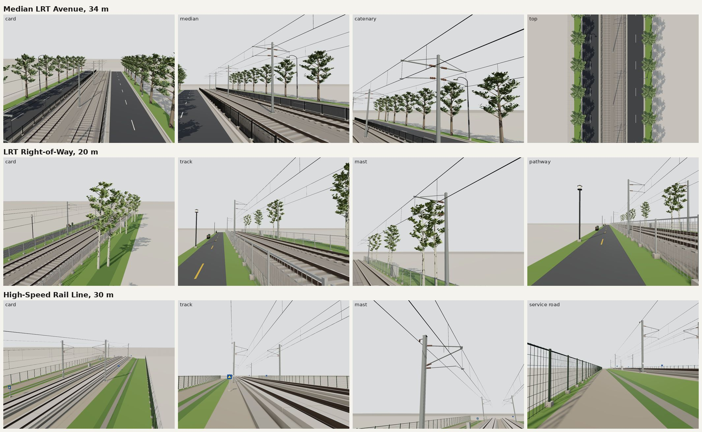

# Rail streets: median LRT, LRT right-of-way and high-speed rail

## Scope

Three drawable rail corridors, chosen on 2026-11-20 from a proposed set of four light-rail
and four high-speed pieces:

- **Median LRT Avenue** (`student_median_lrt_avenue_v1`), 34 m.
- **LRT Right-of-Way** (`student_lrt_right_of_way_v1`), 20 m.
- **High-Speed Rail Line** (`student_high_speed_rail_line_v1`), 30 m, under a new
  catalogue archetype, **High-Speed Rail Corridor** (`high_speed_rail_corridor`).

Students draw them like the other native streets: pick the card, click a route with
bends or curves, from one cycle long (40 m, or 50 m for high-speed) up to 2 km. The
engine repeats one fixture cycle along the route, bends the rails, wires, ballast and
markings with it, and drops rigid modules near junctions and sharp bends.

They are original teaching sections, not City of Calgary or rail operator drawings.
Stations, platforms, crossings, turning lanes and trains are not modelled.

## The sections

All three carry standard-gauge (1,435 mm) double track with flat-bottom rails and an
overhead contact line: a contact wire and a messenger above each track, with droppers.

### Median LRT Avenue, 34 m, 40 m cycle

| Zone | Width | Surface |
|---|---:|---|
| Sidewalk | 2.5 m | Concrete, control joints |
| Boulevard | 2.5 m | Grass, green ash every 10 m, davit light |
| Road | 7.0 m | Two 3.5 m lanes, dashed lane line, curb and gutter both sides |
| Median | 10.0 m | Raised curbs, 1.2 m black picket fence, ballasted double track |
| Road, boulevard, sidewalk | 12.0 m | As the west side |

- Track centres 4.6 m, so a centre pole clears each light-rail vehicle.
- Concrete sleepers every 0.625 m, half-buried in a ballast bed 0.25 m above the road.
- Centre poles every 20 m, with twin cantilevers.
- Contact wire 5.6 m above the rail head, 6.1 m above the road; messenger 1.0 m above.
- The card has four lanes; the median fence opens wherever another street meets it.

### LRT Right-of-Way, 20 m, 40 m cycle

| Zone | Width | Surface |
|---|---:|---|
| Verge | 1.0 m | Grass, a pathway light, bench and bin |
| Regional pathway | 3.0 m | Asphalt with a yellow dashed centre line |
| Buffer | 1.5 m | Grass, 1.8 m galvanised chain-link fence |
| Track bed | 9.0 m | Ballasted double track on a gravel formation |
| Buffer | 1.5 m | Grass, fence |
| Swale | 4.0 m | Grassed drainage swale, aspen clumps, a relay case |

- Track centres 4.0 m.
- Side masts 4.2 m from the centre, one pair per 40 m.
- Contact wire 5.2 m above the rail head; messenger 1.1 m above.
- No motor lanes.

### High-Speed Rail Line, 30 m, 50 m cycle

| Zone | Width | Surface |
|---|---:|---|
| Margin | 1.0 m | Grass, 2.4 m green weldmesh security fence |
| Maintenance road | 3.5 m | Gravel |
| Ditch | 2.0 m | Grassed, rock-lined channel |
| Formation | 17.0 m | 0.8 m embankment, 13 m crest, double slab track |
| Ditch | 2.0 m | As the west |
| Margin | 4.5 m | Grass, security fence |

- Track centres 4.8 m.
- Each track sits on a 3.2 m bound base layer and 2.55 m slabs 6.2 m long.
- Cable troughs run beside the tracks.
- H-section masts, one pair per 50 m, stand 3.0 m from the near track centre.
- Contact wire 5.3 m above the rail head, with a 1.6 m system height.
- A feeder wire runs behind each mast line.
- A trackside cabinet, and blank blue marker boards facing approaching trains.
- No level crossings exist on such lines. Where students cross it with a street, a
  bridge or underpass is implied; the engine still draws a flush junction.

## The new archetype

`high_speed_rail_corridor` joins the street catalogue in **Transit Oriented**, with one
variant, **Slab Track at Grade**. Its card images are renders of the model, not AI
images.

- **Images:** `hero.png`, `variant_0.png` and `.webp` under
  `frontend/public/archetypes/streets/high-speed-rail-corridor/`.
- **Section:** an explicit section, so its own AI render prompt describes the
  corridor rather than two asphalt lanes.
- **Registered in:**
  - the backend trust index, regenerated with
    `backend/scripts/export_public_realm_catalog_ids.py`;
  - the reference-availability index;
  - `archetypeShadeMap.ts`, with a unique zone colour.

## Engine change

A native street's section band may now name its `zoneType` and `surface`.
`streetSectionProfiles.ts` uses them in place of the inference from band names and
materials. All three track beds declare `rail_track`, so section summaries and AI
render prompts say rail track instead of stone paving or planting. Bands without
them, which means every existing street, resolve exactly as before.

## Budget per cycle

| Street | Module triangles | Ground triangles | Per km |
|---|---:|---:|---:|
| Median LRT Avenue | 73,736 (trees 62,784) | 1,764 | about 1.9 million |
| LRT Right-of-Way | 29,640 (aspens 18,480) | 1,606 | about 0.78 million |
| High-Speed Rail Line | 12,342 | 578 | about 0.26 million |

The engine batches identical modules. Like Stephen Avenue, most of the avenue's load is
its trees.

## Verification

- `tools/rail_streets/test_rail_streets.py`, 24 tests:
  - the generator is deterministic, and reproduces the registered rows and module bytes;
  - sections tile the width, and each names one rail track bed;
  - every module stays within the corridor and its cycle;
  - nothing below 4 m stands in a train envelope, and nothing below 2.2 m on a lane
    or pathway;
  - rails are standard gauge and continuous;
  - each cantilever ends on its contact wire;
  - only the avenue carries traffic;
  - the high-speed dimensions are as above.
- `frontend/src/features/pickPlace/railStreets.test.ts`, 15 tests on the real engine:
  - each card is an ordinary drawable street card;
  - the track bed resolves as rail track;
  - straight, bent, curved and 2 km routes are accepted, and shorter routes refused;
  - every module repeats along a long route;
  - rails and wires bend along a curve from one end of the route to the other.
- Backend: the native street contract admits all three with trusted parents and exact
  module locks; the trust index includes the new archetype.
- Existing tests updated for three more cards and one more archetype.
- The full frontend suite, type check and lint pass. The backend street and catalogue
  tests pass. In this container, 12 backend tests fail and 16 error: the model-generation
  and worker tests that need `pygltflib`, a database or Redis, none of which are installed.
- Runtime asset manifest: 6,045 required files (+21: 15 modules and 6 card images).

## Runtime trial handoff

Everything needed for a runtime trial is on `claude/tender-albattani-fsnp50`, based on
`deployment-version`:

- **Runtime reviews:** one per variant under `tools/rail_streets/runtime-review/`,
  following the repository template. Every applicable gate and matrix row is NOT TESTED;
  building, park and bridge rows are N/A with reasons. Each ends with rail-specific checks
  and the classroom impact of the open items.
- **Modules and card images** are in Git LFS: run `git lfs pull` after checkout.
- **Trial steps:**
  - start the app as `CLAUDE.md` describes;
  - prepare a level site;
  - draw each street from the Streets and Pathways picker;
  - work through its review, recording evidence row by row.
- **Separate decisions:** visual acceptance and publication stay separate from the
  runtime review. All three remain `local-pilot-runtime-pending` until a person
  approves them.

## Open checkpoints

- **Runtime: NOT TESTED.** Nothing was drawn in the running app.
- **Independent review:** not done; the builder reviewed the renders.
- **Human visual acceptance:** open.
- Route ends show the open cross-section of the ballast bed and embankment.
- Curves are not checked against the large radii real high-speed lines need.
