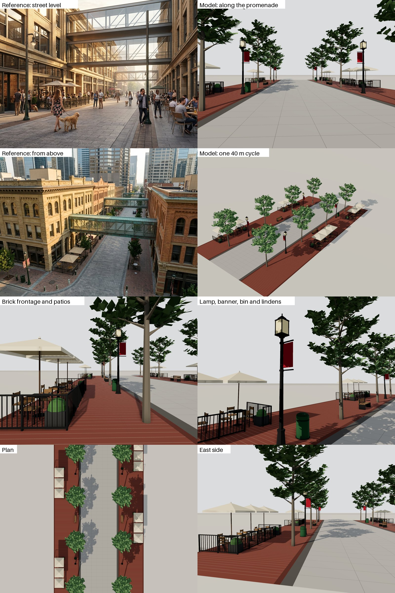

# Stephen Avenue Pedestrian Mall

## Scope

A drawable street for the catalogue's **Stephen Avenue Pedestrian Mall**
(`stephen_avenue_pedestrian_mall`), registered as the local pilot
`student_stephen_avenue_mall_v1`. Students draw it like the other native streets:
pick the card, click a route with bends or curves, 30 to 300 m long, and the
street follows it.

**Street only.** As requested, there are no buildings, storefronts or +15
skywalks. Students add buildings along it from the building catalogue.

## Design basis

An original teaching section after the catalogue's twelve Stephen Avenue images
(four variants, each with street, oblique and plan views). All four show the same
street under different light:

- a grey granite promenade with a darker granite edge;
- red brick zones along both frontages;
- cafe patios behind black railings, with cream umbrellas;
- lindens in square grates;
- black heritage lamps with red banners;
- green litter bins.

It is not a City of Calgary drawing.

## The section

20 m wide, flush, with no curbs and no motor lanes.

| Zone | Width | Surface |
|---|---:|---|
| West frontage | 5.6 m | Red brick with mortar course lines and a dark soldier course at each edge |
| Border | 0.4 m | Dark granite |
| Promenade | 8.0 m | Grey granite pavers, 1.2 m by 0.8 m joints |
| Border | 0.4 m | Dark granite |
| East frontage | 5.6 m | Red brick, as the west |

Along each brick zone, 5.2 m from the centre, stand lindens, lamps, a bench and a
bin. Behind them, 1.6 m of clear brick walk runs past the patios, which stand
against each frontage. The promenade carries nothing, so 7.6 m stays clear for
walking, emergency vehicles and service access.

## Modules

Five modules, drawn in Python. The engine repeats one 40 m cycle of them along
the route and drops any that would stand in a junction or bend clearance.

| Module | Per 40 m | Triangles | Size |
|---|---:|---:|---:|
| Littleleaf linden in a 1.5 m iron grate, crown from 2.7 m, 7.8 m tall | 8 | 7,338 | 839 KB |
| Heritage lamp, 4.8 m, lantern and a red banner without lettering | 4 | 396 | 47 KB |
| Cafe patio, 7 m by 2.4 m: picket railing with an entrance gap, three umbrellas, three tables, twelve chairs, two planters | 4 | 2,996 | 343 KB |
| Litter bin | 2 | 204 | 24 KB |
| Bench, 1.8 m, backed | 2 | 156 | 19 KB |

About 73,000 module triangles per 40 m, mostly the trees; a 300 m route submits
about 550,000. Patios are open on their building side, where a frontage would
stand.

## Verification

- `tools/stephen_avenue_street/test_stephen_avenue.py`, 7 tests:
  - the generator writes the registered row, module bytes and bounds exactly;
  - the roster, card and hero bind the same revision;
  - the sections tile the full width;
  - no ground footprint stands on the promenade or the frontage walks;
  - every item fits its cycle and zone;
  - there are no motor lanes.
- `frontend/src/features/pickPlace/stephenAvenue.test.ts`, 5 tests on the real
  engine:
  - the card is an ordinary drawable street card, 20 m wide, with no lanes;
  - straight, bent, curved and 300 m routes are accepted, and 29 m and 2,001 m
    routes are refused;
  - a 160 m route places every authored item four times, and none stands on the
    promenade or its borders;
  - no two pieces of furniture overlap, within a cycle or across its ends;
  - a bent route draws all six surface materials from the street's palette, at
    the shared base lift.
- The backend contract admits it as a native street candidate with a trusted
  parent and exact module locks.
- Existing tests updated for one more card:
  - the street card count, 44 to 45;
  - the packaged native street count, 32 to 33;
  - the backend list of runtime streets;
  - the production roster test, which names the street as an explicit addition
    so older fingerprints are unchanged.
- Runtime asset manifest: 6,016 required files (+5, the modules).

## Open checkpoints

- **Runtime: NOT TESTED.** Nothing was drawn in the running app; that needs a map
  key and a local database.
- **Independent review:** not done; the builder reviewed it.
- **Human visual acceptance:** open.
- The hero card image is the catalogue's own Heritage Daytime photograph, which
  shows buildings and +15s that the drawn street does not include.
