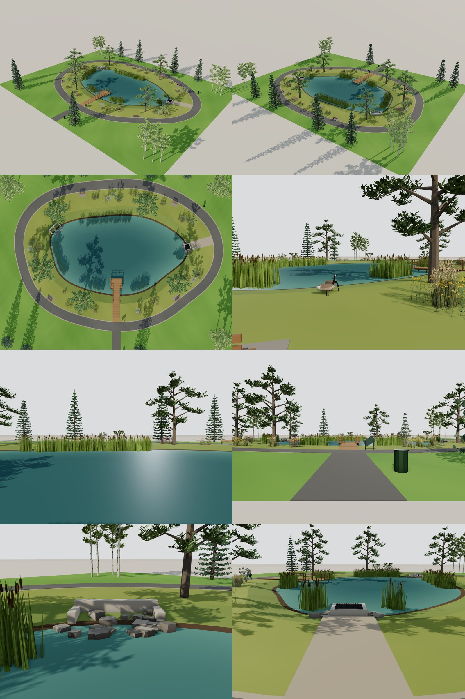

# Stormwater Pond & Pathway Loop

## Scope

A new native park, `student_stormwater_pond_v1`, for the catalogue's
**Stormwater Retention Pond** archetype (`stormwater_retention_pond`). Until now
that archetype had reference images but no 3D park. It is registered as a pilot
in the **Water** group of the Calgary guide, like the other 27 native parks.

Views, left to right and top to bottom: aerial from the south-west, aerial from
the north-east, plan, eye level from the loop, eye level from the dock, the
south entrance, the inlet headwall, the outlet structure.

## Design basis

An original concept after the catalogue's stormwater pond reference images,
enlarged from their garden-sized pond toward a Calgary neighbourhood wet pond:
open water ringed by cattails and native meadow, a paved loop that sets back
from the water, and visible inlet and outlet structures. It is a teaching model
of the type, **not a hydraulic or engineered design**.

## What was built

- **Site.** 86 by 68 m on prepared level ground, entered from the south on a
  3 m paved spur.
- **Pond.** An irregular oval about 46 by 27 m. The water is one flat surface
  0.45 m below grade, darker in the middle and lighter at the shallows.
- **Banks.** A 0.5 m mud margin, then grassed banks at about 1 in 7 out to
  meadow.
- **Loop.** A 3 m asphalt path 9.5 to 12.5 m out from the water's edge, with
  0.25 m gravel shoulders and low kerbs. Mown lawn runs out to the site edge.
- **Viewing dock.** A 2.4 m timber dock on the south side: a ramp, then a deck
  0.17 m above grade on posts, with 1.07 m railings and a 4 m end platform.
- **Drainage structures.**
  - Inlet: a concrete headwall with a pipe opening, set in rip-rap.
  - Outlet: a control box with a grate, reached by a gravel access path.
- **Furniture.** Benches at four lookouts, each facing the water. Also a sign
  where the entrance path meets the loop, and two waste bins.
- **Planting.** All of it comes from the shared prairie foliage kit:
  - cattails in two staggered rows along the shallows, broken where the dock,
    inlet and outlet meet the water;
  - laurel-leaf willows at the water;
  - meadow drifts of rough fescue, feather reed grass, fireweed and goldenrod;
  - wolf willow, highbush cranberry and snowberry shrubs;
  - aspen groves at three corners and white spruce;
  - a pair of Canada geese from the wildlife set.
- **Size.** 634,888 triangles rendered from 35 unique meshes placed 490 times.
  The GLB is self-contained at 6,458,896 bytes, with vertex colours and stored
  normals and no textures.

## Runtime contract

- The assembly owns its ground and stays rigid. A larger parcel leaves room
  around it; nothing stretches.
- Walking surfaces are the materials `paving`, `grass` and `deck`. The registry
  entry sets `walkSurfaceMaterials` to that list, so the dock is walkable.
- The material `water` is a hazard, as everywhere in the runtime.
- The ground is drawn with its normals facing up and with stored normals. Flat
  shading without stored normals had left some faces black, depending on
  winding.

## Verification

- `tools/stormwater_pond_park/verify.py` reads the delivered GLB and passes all
  12 checks (`PASS_OFFLINE_GEOMETRY`):
  - hashes, self-contained buffers and no textures;
  - the footprint, and recipe bounds that match the GLB;
  - one water plane;
  - 1,374 route rays that land on a walkable surface across every route's
    width;
  - 479 plant and bird instances clear of every route;
  - a paved entrance spur.
- `tools/stormwater_pond_park/test_stormwater_pond.py` rebuilds the seeded
  package byte for byte and re-runs the checks.
- `frontend/src/features/parks/stormwaterPond.test.ts` loads the registered
  layout through the runtime walk code. The entrance, loop and dock are
  walkable at their heights; the water and the area outside the site are not.
- Frontend suites for pickPlace, parks and calgaryCatalogue: 143 files, 1,589
  tests pass. Three catalogue tests needed the new card added:
  - the presentation copy;
  - the hero photo, which is the archetype's existing
    `stormwater-retention-pond/hero.png`;
  - the production roster test, which now names the pond as an explicit
    addition so the older fingerprints stay unchanged.
- Backend registry tests (56), hosted-asset tests (23), lint with zero warnings
  and the type check pass. Both registry copies are identical.
- Runtime asset manifest: 6,011 required files (+2: the GLB and the card image).
  The recovered details were installed from their LFS archive for the
  generator, then removed.

## Open checkpoints

- **Runtime: NOT TESTED.** Nothing was placed in the running app. The filled
  template is `seed/classroom-parks/stormwater-pond-v002/runtime-review.md`.
- **Human visual acceptance:** open. The review views above are the builder's
  own.
- **Site design limits**, also listed in the recipe:
  - Real Calgary wet ponds are often 1 to 5 ha. This park shows the type at a
    size the catalogue can place.
  - Nothing sizes storage or models drainage. The water does not connect to
    mapped water.
  - Safety signage, fencing, ice safety and maintenance access need site
    design review.
