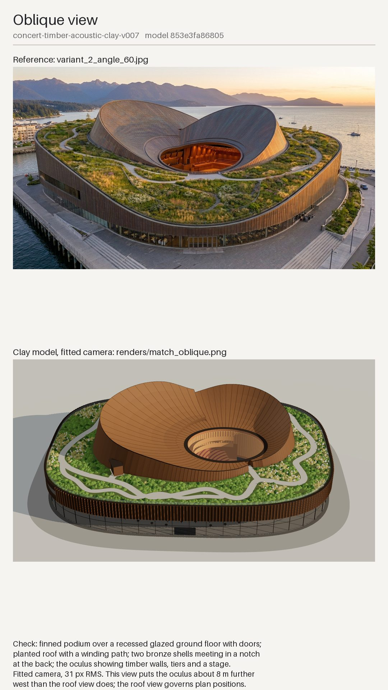

# Concert hall pilot: Timber Acoustic

An RLASM 6.1 architectural-clay model of `concert_hall_modern` / `concert_timber_acoustic`
(variant 2, "Timber Acoustic"), generated in pure Python from measured constants. It is a
local pilot: not in the catalogue, not runtime-tested and not approved for publication.



## What the model is

- **Podium:** a rounded rectangle 88 m by 64.4 m (a superellipse, exponent 3.3).
  - The glazed ground floor runs to 6.0 m, set 1.0 m back under the band, with mullions
    about every 4.8 m, a transom over the door heads and a foyer behind it.
  - A band of close bronze fins runs from 6.0 m to the 11.2 m coping, with a ribbon window
    in a 0.35 m reveal at the west end and rooms behind it.
- **Doors:** five glazed leaves at the south centre (the main doors), four at the east, and
  a service door in an opaque back-of-house at the north-east. Thresholds sit 0.13 m
  above the 20 mm apron.
- **Roof garden** at 10.6 m:
  - a glass guard set 1.0 m in from the coping;
  - a winding path loop midway between the shells and the guard, a south-west walk, and
    spurs to the oculus lip and to a vestibule in the foot of the west shell;
  - drifts of low meadow, green and shrub mounds with pale flower clumps.
- **Shells:** two spiral sheets clad in bronze battens round an oval oculus 23.8 m by 18.8 m,
  centred 11.4 m east and 1.7 m south of the podium centre.
  - The west sheet rises to 23.6 m and the east to 21.6 m.
  - Their outer walls lean in 0.28 m per metre of rise, and the rims carry a dark cap.
  - At the north they meet in a radial notch, where the west sheet steps up over the east.
  - The east sheet runs on under the west as a narrow ring on the oculus lip.
- **Auditorium,** seen through the clear oculus glazing:
  - 11 raked tiers with seat strips (about 340 stalls seats) facing a stage on the east;
  - choir terraces behind the stage;
  - two balcony rings and vertical acoustic panels.
- **Apron:** a 6 m paved apron round the podium. The complete model is 100 m by 76.4 m by
  23.7 m, with about 46,000 triangles in 33 clay roles and no textures.

## Sources and conflicts

| Role | File | Use |
|---|---|---|
| Oblique | `variant_2_angle_60.jpg` | Heights, facade, the shells' form, the hall |
| Roof | `variant_2_angle_90.jpg` | Plan positions, at 0.0991 m/px |
| Street (excluded) | `variant_2.png` | The grey preview of the old LEGO model, not this building |

Open for a person to rule on:

1. **Gate A.** Variant 2 has no usable street view. The model follows the oblique and roof
   views. A person must accept that, or supply a street view, before activation.
2. **The oculus position.** The oblique puts the oculus about 3.5 m east of the podium
   centre and the roof view 11.3 m. The roof view governs plan positions; the oblique
   governs heights.
3. **Heights.** A pinhole camera fitted to 39 traced podium points in the oblique fits about
   equally well (31 px RMS) for an 11 m or a 21 m podium. The podium therefore takes the
   catalogue's two 5 m floors.
4. **Inferred parts.** The interiors, the north and east ground floor, the roof-garden
   entrance and the hall's size are inferred. The hall is only as large as the oculus.

`prework-manifest.json` records the locks, measurements, conflicts and assumptions.

## Files

| File | Purpose |
|---|---|
| `build.py` | The generator. Writes the GLB, `build-report.json` and `prework-manifest.json` into a new directory |
| `cameras.json` | The 17 review cameras, including the fitted `match_oblique` and `match_top` |
| `review.html`, `render.cjs` | Review renders in headless Chromium (three.js, ambient occlusion, sun, fill and shadows) |
| `boards.py` | Four 1080 by 1920 phone boards: oblique, roof, construction and programme |
| `verify.py` | 77 deterministic delivery checks; writes `delivery-verification.json` |
| `test_concert_hall.py` | Generator tests: byte-for-byte rebuild, container, outline, shells, doors, sources and cameras |
| `candidate.json` | The recorded candidate: hash, bounds, doors, auditorium and review status |
| `evidence/` | Builder review, delivery verification and independent review records |
| `integration/` | The unapproved promotion package and the runtime review (every gate NOT TESTED) |

## Reproduce

```bash
python3 tools/catalogue_concert_hall_pilot/build.py --output artifacts/concert-hall/v007 --version 7
python3 -m http.server 8765 --bind 127.0.0.1 &          # from the repository root
node tools/catalogue_concert_hall_pilot/render.cjs artifacts/concert-hall/v007/concert-timber-acoustic-clay-v007.glb artifacts/concert-hall/v007/renders
python3 tools/catalogue_concert_hall_pilot/boards.py artifacts/concert-hall/v007
python3 tools/catalogue_concert_hall_pilot/verify.py artifacts/concert-hall/v007
python3 -m pytest tools/catalogue_concert_hall_pilot
```

`build.py` refuses an existing directory, and `render.cjs` and `boards.py` never overwrite
a file. Review builds live under the ignored `artifacts/concert-hall/`. The references are
Git LFS files: `git lfs pull --include="frontend/public/archetypes/buildings/concert_hall_modern/*" --exclude=""`.

## Checkpoints

- Builder review: pass (`evidence/builder-pixel-review.json`).
- Independent architectural-clay review: see `candidate.json`.
- Runtime integration: NOT TESTED. Publication and activation: not authorized. Only a
  person can activate the model.
