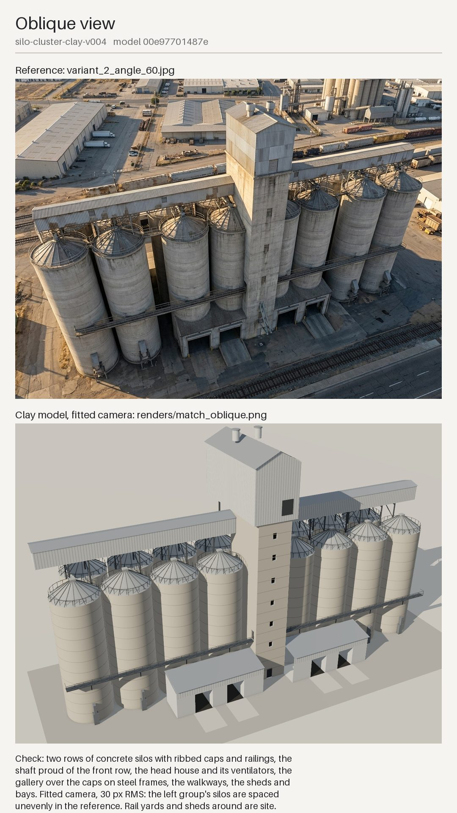

# Silo cluster pilot: Silo Cluster

An RLASM 6.1 architectural-clay model of `machine_aesthetic_heavy_industrial` /
`heavy_silo_cluster` (variant 2, "Silo Cluster"), generated in pure Python from measured
constants. It is a local pilot: not in the catalogue, not runtime-tested and not approved for
publication.



## What the model is

- **Silos:** two rows of eight poured-concrete silos, 9.2 m across at a 9.6 m pitch.
  - Their walls rise 26 m, with pour lines every 2.4 m.
  - The conical caps rise 3 m, with sixteen ribs, an apex hatch and a ring railing.
  - The outer silos have discharge spouts at their feet.
  - The front row parts round the elevator shaft, so it runs 7 m longer than the back row.
- **Elevator shaft:** concrete, 36 m high, standing 2.3 m proud of the front row. It has a
  column of six windows in recessed openings, a door at grade, and doors onto the walkways.
- **Head house:** corrugated steel over both rows, eaves at 47 m and ridge at 49.5 m.
  - It has gable ends, a closed underside, roof overhangs and a louvre in the front gable.
  - Two ventilators stand on the ridge.
  - Two posts carry its north overhang down to the back row's caps.
- **Conveyor gallery:** 86 m long, from 31 to 35 m, over the caps on steel frames at every
  column, with corrugated sides, gable ends and a closed underside.
- **Loading front:**
  - two sheds, each two silos wide, with two truck bays each, 3.8 m by 4.6 m, opening into
    5.4 m deep interiors, and concrete pads in front;
  - walkways at 10 m along the front row, with guard and mid rails, ending at the shaft.
- **Size:** a concrete yard round the cluster. The complete model is 94 m by 38.8 m by 51.1 m,
  with about 26,000 triangles in 15 clay roles, 1.3 MB, and no textures.

## Sources and conflicts

| Role | File | Use |
|---|---|---|
| Oblique | `variant_2_angle_60.jpg` | Heights by proportion, the elements and their order |
| Roof | `variant_2_angle_90.jpg` | Plan positions, at 0.0756 m/px |
| Street (excluded) | `variant_2.png` | A grey render of the old LEGO model, not this building |

Open for a person to rule on:

1. **Gate A.** Variant 2 has no usable street view. The model follows the oblique and roof
   views. A person must accept that, or supply a street view, before activation.
2. **Heights.** These are proportioned in the oblique. A nine-point camera fit gave similar
   values but was too loose to govern (32 px RMS). The fitted match camera has 30 px RMS, most of
   it from the reference's uneven silo spacing in the left group.
3. **The roof view** is not overhead: tall parts lean north by about 2 px per metre. Plan
   positions come from the caps and from the feet of the shaft and sheds.
4. **Footprint.** The catalogue suggests 80 by 50 m; the images show a long cluster about 86 by
   25 m, and the images govern.
5. **Inferred parts.** The back row's north side, the ends, the shaft's back and all interiors
   are inferred. The walkways' stairs are not modelled.

`prework-manifest.json` records the locks, measurements, conflicts and assumptions.

## Files

| File | Purpose |
|---|---|
| `build.py` | The generator. Writes the GLB, `build-report.json` and `prework-manifest.json` into a new directory |
| `cameras.json` | The 17 review cameras, including the fitted `match_oblique` and the orthographic `match_top` |
| `review.html`, `render.cjs` | Review renders in headless Chromium |
| `boards.py` | Four 1080 by 1920 phone boards: oblique, roof, construction and whole views |
| `verify.py` | 76 deterministic delivery checks; writes `delivery-verification.json` |
| `test_silo_cluster.py` | Generator tests: byte-for-byte rebuild, container, rows measured from the roof view, the order of parts, the loading front, sources and cameras |
| `candidate.json` | The recorded candidate: hash, bounds, heights, doors and review status |
| `evidence/` | Builder review, delivery verification and independent review records |
| `integration/` | The unapproved promotion package and the runtime review (every gate NOT TESTED) |

## Reproduce

```bash
python3 tools/catalogue_silo_cluster_pilot/build.py --output artifacts/silo/v004 --version 4
python3 -m http.server 8765 --bind 127.0.0.1 &          # from the repository root
node tools/catalogue_silo_cluster_pilot/render.cjs artifacts/silo/v004/silo-cluster-clay-v004.glb artifacts/silo/v004/renders
python3 tools/catalogue_silo_cluster_pilot/boards.py artifacts/silo/v004
python3 tools/catalogue_silo_cluster_pilot/verify.py artifacts/silo/v004
python3 -m pytest tools/catalogue_silo_cluster_pilot
```

`build.py` refuses an existing directory, and `render.cjs` and `boards.py` never overwrite
a file. Review builds live under the ignored `artifacts/silo/`. The references are Git LFS
files: `git lfs pull --include="frontend/public/archetypes/buildings/machine_aesthetic_heavy_industrial/*" --exclude=""`.

## Checkpoints

- Builder review: pass (`evidence/builder-pixel-review.json`).
- Independent architectural-clay review: see `candidate.json`.
- Gate A: open for a person (the street view is a LEGO render).
- Runtime integration: NOT TESTED. Publication and activation: not authorized. Only a
  person can activate the model.
