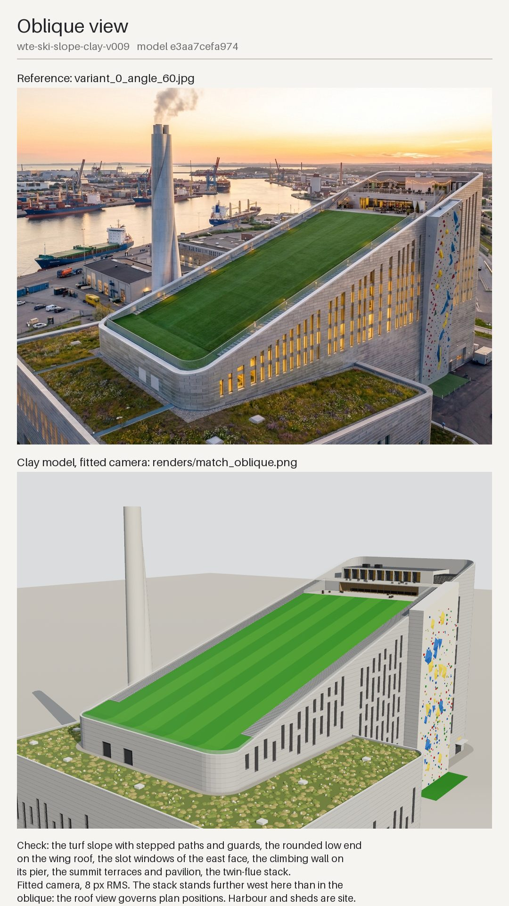

# Ski-slope plant pilot: Ski Slope WtE

An RLASM 6.1 architectural-clay model of `waste_to_energy_plant` / `wte_ski_slope`
(variant 0, "Ski Slope WtE"), generated in pure Python from measured constants. It is a
local pilot: not in the catalogue, not runtime-tested and not approved for publication.



## What the model is

- **Main block:** 60 m by 159 m with rounded corners, clad in aluminium bricks drawn as
  course lines every 1.25 m.
  - Its parapet climbs in one straight line from 39.5 m at the low end to the 80.2 m
    summit, as the oblique shows.
  - The long faces carry tall slot windows in staggered columns. Each one is cut through
    the wall, with reveals, glass, glazing bars and a lit room face 1.4 m behind, and stops
    1.2 m below the walking surface above it.
- **The roof:**
  - one green turf slope in groomed stripes;
  - a stepped path down each side, with 0.18 m risers, and gravel edge strips;
  - parapets with a glass guard beside the slope.
- **The summit:**
  - a lower terrace with tables, in front of a glazed bar with a lit interior;
  - short flights up to the upper terrace, guarded on their open side, and a glass guard
    along the upper terrace's front;
  - a pavilion with lit glazing, a dark roof and rooftop units, and a louvred plant enclosure.
- **Street front** (the long east face of the roof view, facing -y):
  - a visitor entrance, cut into the wall with framed glazed doors under a transom, a
    canopy and a lit sign;
  - a climbing wall on a closed pier standing 5.3 m proud of the face, with 26 large volumes
    and 240 holds in four colours, and a turf pad at its foot.
- **Other doors:** two slatted roller doors in the back (north) end; two service doors from
  the wing roof into the low end.
- **Wings:** green-roofed wings 29.8 m high wrap the south half and run north beside the
  block as a narrow west strip. They have planting, gravel strips, hatches and an upstand,
  with slot windows on their straight walls.
- **Stack:** twin tapering flues, the second winding 110 degrees round the first, both 100 m
  high, standing in a gravel ring on the west wing roof.
- **Size:** a 4 m apron round the whole. The complete model is 183 m by 111 m by 100 m, with
  about 67,000 triangles in 31 clay roles, 4.7 MB, and no textures.

## Sources and conflicts

| Role | File | Use |
|---|---|---|
| Oblique | `variant_0_angle_60.jpg` | Heights (fitted camera), facades, the summit |
| Roof | `variant_0_angle_90.jpg` | Plan positions, at 0.204 m/px |
| Street (excluded) | `variant_0.png` | A grey render of the old LEGO model, not this building |

Open for a person to rule on:

1. **Gate A.** Variant 0 has no usable street view. The model follows the oblique and roof
   views. A person must accept that, or supply a street view, before activation.
2. **Heights.** A pinhole camera fitted to eight points of the block in the oblique (8.2 px
   RMS), with the plan held fixed, gives the summit, low-end and wing-roof heights. A wing
   roof below 20 m fits clearly worse.
3. **The stack.** The roof view draws it leaning, with its flue about 30 m north-west of its
   base; the oblique shows it upright and further east. Its base follows the roof view and
   its height the oblique.
4. **Footprint.** The catalogue suggests 160 by 70 m. The images show wings that make the
   whole 103 m wide; the images govern.
5. **Inferred parts.** The west and north faces, the wings' southern end and all interiors
   are inferred.

`prework-manifest.json` records the locks, measurements, conflicts and assumptions.

## Files

| File | Purpose |
|---|---|
| `build.py` | The generator, authored in the roof view's plan frame and turned a quarter turn so the street front faces -y. Writes the GLB, `build-report.json` and `prework-manifest.json` into a new directory |
| `cameras.json` | The 18 review cameras, including the fitted `match_oblique` and the orthographic `match_top` |
| `review.html`, `render.cjs` | Review renders in headless Chromium |
| `boards.py` | Four 1080 by 1920 phone boards: oblique, roof, construction and whole views |
| `verify.py` | 78 deterministic delivery checks; writes `delivery-verification.json` |
| `test_ski_slope_plant.py` | Generator tests: byte-for-byte rebuild, container, outline, parapet and stairs, street front, wings, sources and cameras |
| `candidate.json` | The recorded candidate: hash, bounds, heights, doors and review status |
| `evidence/` | Builder review, delivery verification and independent review records |
| `integration/` | The unapproved promotion package and the runtime review (every gate NOT TESTED) |

## Reproduce

```bash
python3 tools/catalogue_ski_slope_plant_pilot/build.py --output artifacts/ski-slope/v009 --version 9
python3 -m http.server 8765 --bind 127.0.0.1 &          # from the repository root
node tools/catalogue_ski_slope_plant_pilot/render.cjs artifacts/ski-slope/v009/wte-ski-slope-clay-v009.glb artifacts/ski-slope/v009/renders
python3 tools/catalogue_ski_slope_plant_pilot/boards.py artifacts/ski-slope/v009
python3 tools/catalogue_ski_slope_plant_pilot/verify.py artifacts/ski-slope/v009
python3 -m pytest tools/catalogue_ski_slope_plant_pilot
```

`build.py` refuses an existing directory, and `render.cjs` and `boards.py` never overwrite
a file. Review builds live under the ignored `artifacts/ski-slope/`. The references are
Git LFS files: `git lfs pull --include="frontend/public/archetypes/buildings/waste_to_energy_plant/*" --exclude=""`.

## Checkpoints

- Builder review: pass (`evidence/builder-pixel-review.json`).
- Independent architectural-clay review: see `candidate.json`.
- Gate A: open for a person (the street view is a LEGO render).
- Runtime integration: NOT TESTED. Publication and activation: not authorized. Only a
  person can activate the model.
